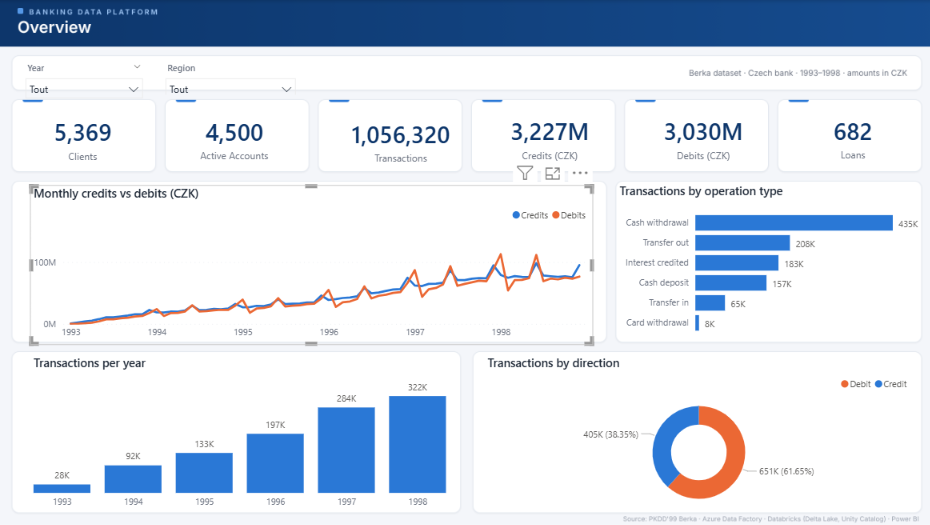
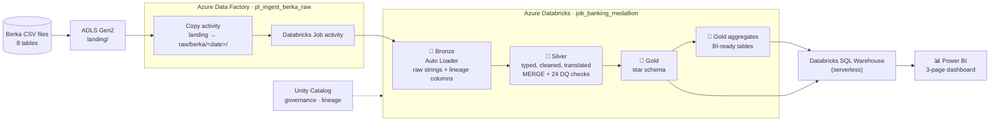
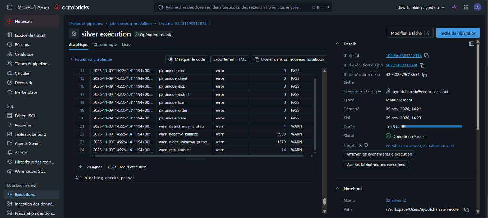
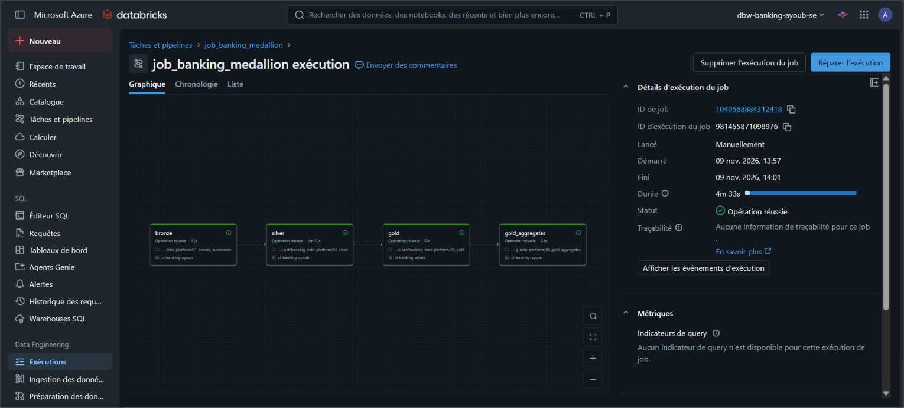
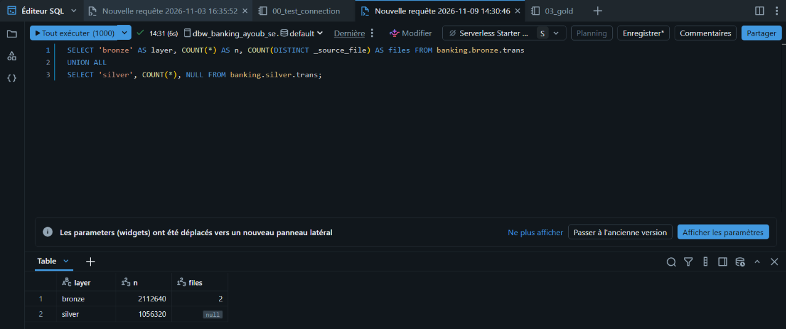
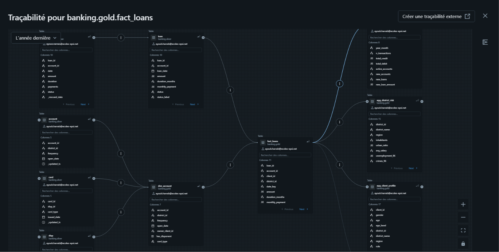
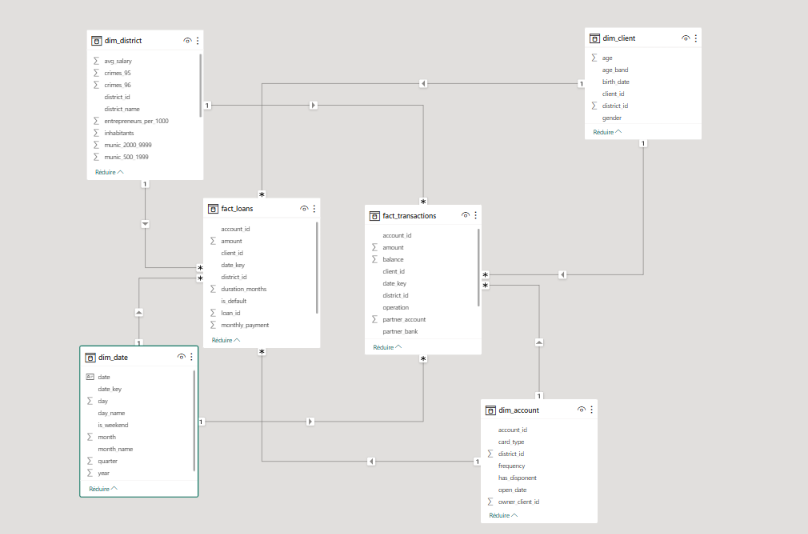
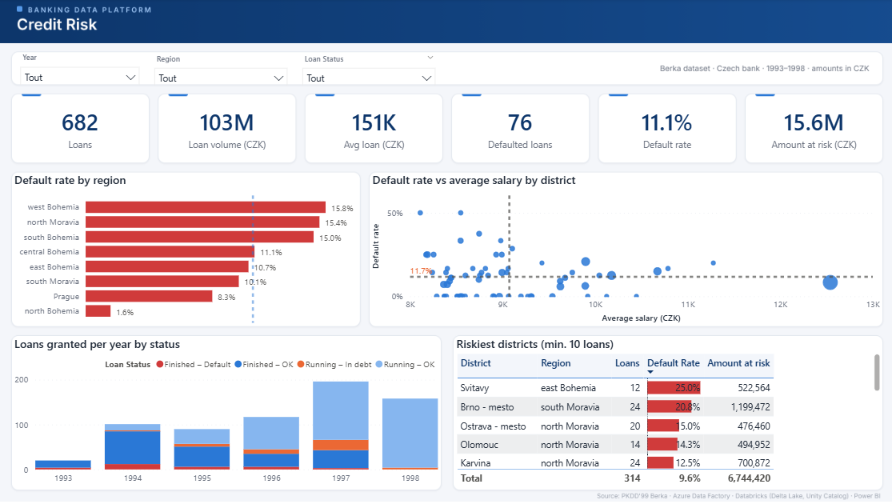
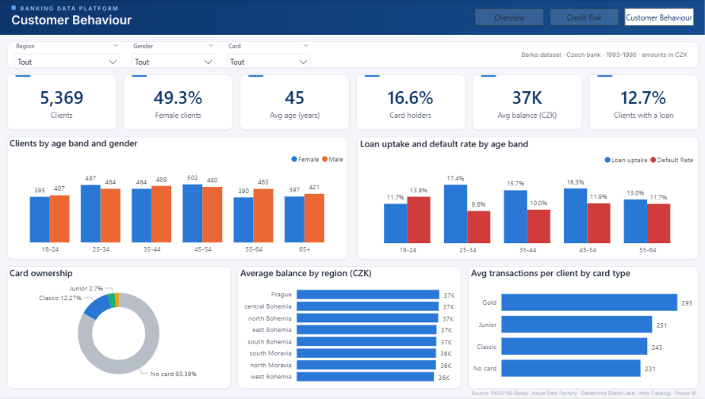

# Banking Data Platform

An end-to-end data engineering project on Azure. It takes the raw CSV files of a Czech bank, builds a governed Lakehouse on Databricks and serves the results in a Power BI dashboard.




## At a glance

| | |
|---|---|
| Dataset | Berka (PKDD'99): real, anonymized data from a Czech bank, 1993-1998 |
| Volume | 8 tables, 5,369 clients, 4,500 accounts, 1,056,320 transactions, 682 loans |
| Architecture | Medallion (Bronze, Silver, Gold) on Delta Lake |
| Orchestration | Azure Data Factory triggers a 4-task Databricks job; a full run takes about 5 minutes |
| Data quality | 24 automated checks (20 blocking, 4 warnings), with results stored in a Delta table |
| Idempotency | Delivering the same files twice adds no duplicate rows to Silver |
| Serving | Star schema (2 facts, 4 dimensions) and 4 aggregate tables, read by a 3-page Power BI report |

## Architecture



### Tech stack

| Layer | Technology | Role |
|---|---|---|
| Storage | ADLS Gen2 (hierarchical namespace) | `landing`, `raw`, `bronze`, `silver`, `gold` containers |
| Ingestion and orchestration | Azure Data Factory, connected to Git | Copies new files, then triggers the Databricks job |
| Processing | Azure Databricks, PySpark, Auto Loader | Bronze, Silver and Gold transformations |
| Table format | Delta Lake | ACID tables, `MERGE` upserts, `OPTIMIZE ZORDER` |
| Governance | Unity Catalog | Catalog `banking`, external locations, automatic lineage |
| Security | Managed identities, Key Vault | ADF reaches Databricks, and Databricks reaches storage, through managed identities; the code holds no secrets |
| Serving | Databricks SQL Warehouse (serverless) | Power BI connection in Import mode |
| BI | Power BI, DAX | Star-schema model, 25 DAX measures, 3 report pages |
| Versioning | Git and GitHub | Notebooks, SQL, infrastructure JSON, ADF pipelines (`main` and `adf_publish`) |

## The dataset

The [Berka dataset](https://sorry.vse.cz/~berka/challenge/pkdd1999/berka.htm) describes the clients, accounts, transactions, loans and cards of a Czech bank.

| Table | Rows | Content |
|---|---:|---|
| `account` | 4,500 | Accounts and statement frequency |
| `client` | 5,369 | Clients (the birth number encodes gender and birth date) |
| `disp` | 5,369 | Links between clients and accounts (owner or co-holder) |
| `card` | 892 | Credit cards (classic, junior, gold) |
| `loan` | 682 | Loans and repayment status |
| `order` | 6,471 | Standing payment orders |
| `trans` | 1,056,320 | Transactions |
| `district` | 77 | Demographic and economic data per district |

Exploring the files in Pandas (`notebooks/01_exploration.ipynb`) turned up these data quality issues:

- Dates stored as `YYMMDD` integers, and card dates with a trailing `00:00:00`
- Gender hidden in `birth_number` (for women, 50 is added to the month)
- Labels in Czech (`PRIJEM`, `VYDAJ`, `POJISTNE`, `SIPO`…)
- The transaction type `VYBER`, which is in fact a debit
- Empty `operation` values that are credited interest
- `?` values in two district statistics
- 2,999 negative balances, 14 zero-amount transactions and 1,379 orders without a purpose

## Pipeline layers

### Bronze (`notebooks/01_bronze_autoloader.py`)

- Auto Loader (`cloudFiles`) runs with `trigger(availableNow=True)`, so each run processes only the new files and then stops.
- One generic function ingests the 8 tables from every dated delivery folder (`raw/berka/<date>/`).
- All columns stay as `string`; no business logic runs at this stage.
- Each row carries `_ingest_ts`, `_source_file` and `_rescued_data`.
- Checkpoints prevent a file from being ingested twice.

### Silver (`notebooks/02_silver.py`)

- Columns are typed, `YYMMDD` values become `DATE`, and gender and birth date are decoded from `birth_number`.
- Czech labels are translated (`POPLATEK MESICNE` becomes `monthly`, `PRIJEM` becomes `credit`…).
- Business fixes: `VYBER` is reclassified as `debit`, empty operations become `interest_credited`, and the notebook adds `signed_amount` and `is_default`.
- Writes use `MERGE` with deduplication on the primary key. New rows are inserted, changed rows are updated, and identical rows are left alone.
- The data quality checks described below append their results to `banking.silver._dq_results`.

### Gold (`notebooks/03_gold.py`, `notebooks/04_gold_aggregates.py`)

| Table | Type | Rows |
|---|---|---:|
| `fact_transactions` | Fact | 1,056,320 |
| `fact_loans` | Fact | 682 |
| `dim_client` | Dimension (age, age band, gender) | 5,369 |
| `dim_account` | Dimension (owner, co-holder flag, card type) | 4,500 |
| `dim_district` | Dimension (region, salary, unemployment, crime) | 77 |
| `dim_date` | Dimension (1993-1998) | 2,191 |
| `agg_account_monthly` | Aggregate (account by month, with end-of-month balance) | 185,057 |
| `agg_client_profile` | Aggregate (one row per client) | 5,369 |
| `agg_district_risk` | Aggregate (loans, defaults, socio-economic context) | 77 |
| `agg_monthly_kpis` | Aggregate (bank-wide monthly KPIs) | 72 |

Each build checks referential integrity (0 orphan keys), and `fact_transactions` is compacted with `OPTIMIZE … ZORDER BY (account_id, date_key)`.

## Data quality

24 rules run at the end of the Silver notebook. If a blocking rule fails, the notebook raises an exception and the Databricks job stops before Gold is rebuilt.

| Category | Rules | Severity |
|---|---|---|
| Primary keys unique and not null | 8 (one per table) | Blocking |
| Foreign keys resolve to a parent | 8 (for example `trans.account_id` to `account`) | Blocking |
| Mandatory business columns not null | 3 (`trans`, `loan`, `client`) | Blocking |
| Exactly one owner per account | 1 | Blocking |
| Known anomalies in the source | 4: negative balances (2,999), zero amounts (14), missing district statistics (1), orders without a purpose (1,379) | Warning, logged only |



## Orchestration and idempotency

One ADF trigger runs the whole chain:

```
ADF  pl_ingest_berka_raw
 ├─ copy_landing_to_raw   (16 s)
 └─ run_medallion_job  →  Databricks job_banking_medallion
                            bronze → silver → gold → gold_aggregates   (~5 min)
```



To test idempotency, I delivered the same 8 files a second time (as a new dated folder in `raw/`) and re-ran the full pipeline from ADF:

| Layer | Rows in `trans` | Result |
|---|---:|---|
| Bronze | 2,112,640 (2 source files) | Keeps every delivery |
| Silver | 1,056,320 | `inserted=0 updated=0`: no duplicates and no rewritten rows |



## Governance and lineage

All tables live in the Unity Catalog catalog `banking`, in the `bronze`, `silver` and `gold` schemas, backed by external locations on ADLS Gen2. Unity Catalog records lineage automatically, from the Bronze tables down to the BI aggregates:



## Power BI dashboard

The report connects to the serverless SQL Warehouse in Import mode. Its model is a star schema: 8 many-to-one, single-direction relationships link the 2 fact tables to the 4 dimensions, and `dim_date` is marked as the date table.



| Page | Questions it answers |
|---|---|
| Overview | How active is the bank? Credits and debits over time, transactions per year, by operation and by direction |
| Credit Risk | How healthy is the loan portfolio? Default rate by region, salary against default rate by district, loans by status, riskiest districts |
| Customer Behaviour | Who are the clients? Age and gender, loan uptake and default by age band, card ownership, activity by card type |

The three pages share a custom theme (`powerbi/banking_theme.json`, with a palette checked for colour blindness) and the same page layout. Red appears only on risk metrics.

| Credit Risk | Customer Behaviour |
|---|---|
|  |  |

## What the data shows

- Yearly transactions grew from 28K in 1993 to 322K in 1998.
- 76 of the 682 loans defaulted, an 11.1% default rate. By region it ranges from 1.6% in North Bohemia to 15.8% in West Bohemia.
- Among districts with at least 10 loans, Svitavy has the highest default rate, at 25%.
- Most districts with an above-average default rate have below-average salaries, and the wealthiest districts, Prague included, sit below the average. This is a correlation, and many districts have only a few loans.
- 18-24 is the only age band where the default rate (13.8%) is higher than the loan uptake rate (11.7%).
- Only 16.6% of clients hold a card. Gold card holders make 293 transactions on average, against 231 for clients without a card.
- The average balance is between 36K and 37K CZK in every region.

## Engineering decisions and trade-offs

| Decision | Reason |
|---|---|
| Databricks workspace in Sweden Central, storage in Germany West Central | The student subscription restricts regions and VM sizes; the only 4-vCPU sizes I could actually use were in Sweden Central |
| Cluster created with the Databricks CLI from `infra/cluster.json` | The UI would not let me select the only VM size that fit the quota |
| The job runs on the existing all-purpose cluster | A separate job cluster could not start alongside it within the 4-vCPU quota; I accepted the slightly higher DBU rate |
| Managed identities for every connection | ADF, Databricks and ADLS talk to each other without any stored secret |
| Bronze keeps every delivery, Silver deduplicates | Bronze is the audit trail, Silver is the single source of truth |
| Natural keys from the source in Gold | They are stable and unique (the DQ checks enforce it); `dim_date` uses a `yyyyMMdd` key |
| Aggregate tables for BI | Visuals stay fast and DAX stays simple; the star schema remains available for drill-down |
| Power BI in Import mode | 1M rows fit in memory, and the warehouse only runs during refresh |

## Repository structure

```
banking-data-platform/
├── adf/                          # Azure Data Factory (Git-integrated): pipeline, datasets, linked services
├── docs/
│   ├── architecture.md           # Architecture diagram (Mermaid)
│   ├── data_quality.md           # Data quality findings from exploration
│   ├── star_schema.md            # Star schema design
│   └── images/                   # Screenshots used in this README
├── infra/
│   ├── cluster.json              # Databricks cluster definition (CLI)
│   └── job_banking_medallion.json# Databricks job definition
├── notebooks/
│   ├── 01_exploration.ipynb      # Local exploration with Pandas
│   ├── 01_bronze_autoloader.py   # Bronze: Auto Loader ingestion
│   ├── 02_silver.py              # Silver: cleaning, MERGE, data quality checks
│   ├── 03_gold.py                # Gold: star schema + integrity checks
│   └── 04_gold_aggregates.py     # Gold: BI aggregates + OPTIMIZE
├── powerbi/
│   ├── banking_dashboard.pbix    # Power BI report
│   ├── banking_theme.json        # Custom theme
│   └── bg_*.png                  # Page backgrounds
├── sql/
│   └── 00_unity_catalog_setup.sql# Catalog, schemas, external locations
└── README.md
```

The raw CSV files are not in the repository (see `.gitignore`); download them from the dataset page.

## How to reproduce

1. In Azure, create a resource group, an ADLS Gen2 account (containers `landing`, `raw`, `bronze`, `silver`, `gold`), a Key Vault, a Data Factory and a Databricks workspace (Premium, with Unity Catalog).
2. Create a Databricks access connector and give it *Storage Blob Data Contributor* on the storage account. Give the ADF managed identity the same role, plus *Contributor* on the Databricks workspace.
3. In Unity Catalog, create the storage credential and the external locations, then run `sql/00_unity_catalog_setup.sql`.
4. Create the cluster: `databricks clusters create --json @infra/cluster.json`.
5. Import the four notebooks from `notebooks/` into the workspace.
6. Create the job: `databricks jobs create --json @infra/job_banking_medallion.json` (update the cluster ID and notebook paths first).
7. Connect Data Factory to this repository (root folder `/adf`), update the linked services, then publish.
8. Upload the 8 Berka CSV files to `landing/berka/` and trigger `pl_ingest_berka_raw`.
9. Open `powerbi/banking_dashboard.pbix` and point the Azure Databricks source to your SQL Warehouse.

## Cost and cleanup

The project ran on an Azure for Students subscription. Clusters stop after 20 idle minutes, the SQL Warehouse is serverless, and the workspace has no NAT gateway, which would otherwise bill around the clock. All resources were deleted at the end of the project.

## Possible improvements

- CI/CD: deploy ADF from the `adf_publish` ARM templates and the Databricks code with Asset Bundles.
- Rewrite Bronze and Silver as Delta Live Tables with built-in expectations.
- Unit tests for the transformation functions (`pytest` with a local Spark session).
- Infrastructure as code with Terraform or Bicep.
- A second, live source: daily stock prices from an API.

## Author

Ayoub Harrab, Data Engineer and Data Analyst

[LinkedIn](https://www.linkedin.com/in/ayoub-harrab/) · [Portfolio](https://ayoubharrab.github.io)